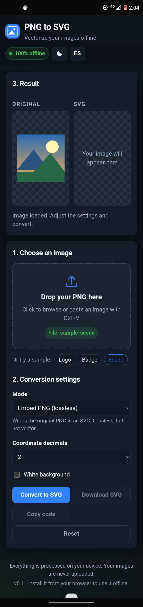
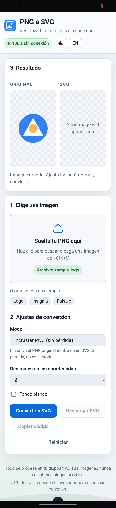

# PNG a SVG · PNG to SVG

[](https://github.com/Yandrox/png-to-svg-free/releases/latest)
[](LICENSE)
[](https://github.com/Yandrox/png-to-svg-free)
[](https://github.com/Yandrox/png-to-svg-free/pulls)
[](https://github.com/Yandrox/png-to-svg-free/commits/main)
[](https://github.com/Yandrox/png-to-svg-free)

PWA **100% offline** para convertir imágenes PNG a SVG sin subir nada a ningún servidor. Todo el motor de vectorización está escrito en JavaScript puro dentro de este repositorio: no hay CDNs, librerías externas, APIs remotas ni servicios de terceros.

An **offline-first PWA** that converts PNG images to SVG entirely on your device. The vector engine is pure JavaScript inside this repository: no CDNs, external libraries, remote APIs or third-party services.

## Características / Features

- **Cuatro modos de conversión / Four conversion modes**
  - Blanco y negro: traza contornos con umbral adjustable → paths vectoriales.
  - Color: cuantización por mediana y un path por color.
  - Escala de grises: niveles ajustables de gris.
  - Incrustar PNG: envuelve el original en SVG sin pérdida (no vectorial).
- Ajustes: umbral, número de colores/niveles, simplificación (Douglas–Peucker), suavizado Bézier (Catmull–Rom), área mínima para quitar ruido, decimales, invertir, solo contorno y fondo blanco.
- Carga por clic, arrastrar y soltar, o pegar desde el portapapeles (`Ctrl+V`). Tres imágenes de ejemplo generadas localmente.
- Vista previa del original y del SVG, estadísticas (dimensiones, colores, paths, tamaño), código SVG, descarga y copia al portapapeles.
- Bilingüe **español / inglés** con detección automática y preferencia guardada.
- Tema claro/oscuro, diseño responsive e instalable como PWA con service worker y cache offline.
- Límite de procesamiento: imágenes mayores de 1600 px se reducen para evitar bloqueos (se indica en la interfaz).

Settings: threshold, color/level count, Douglas–Peucker simplification, Catmull–Rom Bézier smoothing, minimum area to drop speckles, coordinate precision, invert, outline-only and white background. Load by click, drag & drop or clipboard paste; three locally generated samples. Original/SVG preview, stats, source code, download and copy. Bilingual **Spanish / English**, light/dark theme, responsive layout, installable PWA with an offline service worker. Images over 1600 px are downscaled for responsiveness (the UI says so).

## Uso / Usage

Necesitas cualquier servidor HTTP estático (el service worker no funciona desde `file://`, aunque la app sí funciona como página simple):

```sh
python3 -m http.server 8765
# abre / open http://127.0.0.1:8765/index.html
```

Primera carga: el service worker guarda todos los archivos en caché. Después puedes cerrar el servidor y seguir usando la app; también puedes abrir `index.html` directamente desde el sistema de archivos (sin instalación PWA).

First load: the service worker caches every app file. After that you can stop the server and keep using the app. Opening `index.html` directly from disk also works (without PWA installation).

## Capturas / Screenshots

Interfaz principal en español / Main UI in Spanish:



Vista de resultados y opciones / Results and options view:



Para instalarla en Android/Chrome: abre la URL, espera a que el service worker se active y pulsa **Instalar app** (o usa el menú del navegador → *Añadir a pantalla de inicio*).

## APK para Android / Android APK

También hay una APK lista para instalar, compilada con **WebToApp** a partir de esta misma PWA. Descárgala desde la sección [Releases](https://github.com/Yandrox/png-to-svg-free/releases) (`Png_To_Svg_Free_v1.0.0.APK`, versión `1.0.0`, paquete `cu.yandrox.png2svg`).

An installable APK is also available in [Releases](https://github.com/Yandrox/png-to-svg-free/releases), built from this PWA with **WebToApp** (`Png_To_Svg_Free_v1.0.0.APK`, version `1.0.0`, package `cu.yandrox.png2svg`).

Instalación: abre el archivo `.APK` en tu Android y acepta la instalación desde fuentes desconocidas para el instalador. La app incluye la interfaz y el motor de conversión dentro del paquete, así que funciona sin conexión y sin servidor.

To install: open the `.APK` on your Android device and allow installation from unknown sources for the installer. The UI and conversion engine are bundled inside the app, so it works offline with no server.

## Pruebas / Tests

```sh
node tests/trace.test.js
python3 tools/generate-icons.py   # regenera los iconos PNG / regenerates PNG icons
```

## Estructura / Structure

```
index.html               Interfaz / UI
styles.css               Estilos locales / local styles
manifest.webmanifest     Manifiesto PWA
sw.js                    Service worker (app shell offline)
js/i18n.js               Diccionario ES/EN
js/trace.js              Motor: marching squares, mediana, simplificación, Bézier
js/svg-builder.js        Serialización del SVG
js/app.js                Lógica de interfaz, carga, exportación
js/sw-register.js        Registro del service worker
assets/screenshots/      Capturas de la interfaz / UI screenshots
icons/                   Iconos SVG y PNG (192/512)
tools/generate-icons.py  Generador de iconos sin dependencias
tests/trace.test.js      Pruebas del motor con Node
```

## Licencia / License

MIT. Sin dependencias de terceros. / No third-party dependencies.
